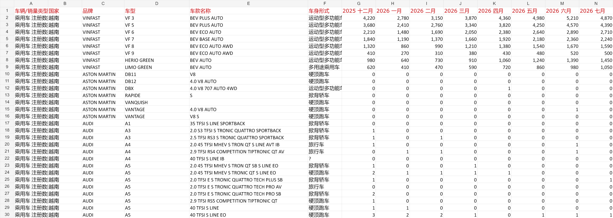

# Automotive Sales Excel

[中文](#中文) · [English](#english) · [Demo](demo/README.md) · [MIT License](LICENSE)

汽车销量与注册量 Excel 模板、模拟数据生成和工作簿检查工具。

Excel templates, simulated market data, and workbook inspection tools for automotive sales and registrations.



## 中文

### 项目简介

本项目包含汽车市场分析母版、固定模板处理规则，以及一个越南乘用车注册量模拟演示。演示基于输入工作簿调整品牌与月份数据，写入越南市场名称和 8 个 VINFAST 车型示例，再导出 Excel 和预览图片。

固定模板规则涵盖车型聚合、中国品牌识别、轿车/MPV/SUV 排名、市占率和月度环比。当前生成脚本主要更新 `Data Export`，尚未实现规则文件中的全部分析与校验流程。

### 快速体验

无需运行代码即可查看 [演示说明](demo/README.md) 或下载 [示例 Excel](outputs/vietnam_simulation/越南乘用车注册模拟数据_2026.xlsx)，用 Excel 打开 `Data Export` 工作表。

若要重新生成演示，需要 **Node.js 20+**，以及能够导入 **`@oai/artifact-tool`** 的运行环境。该依赖由原工作环境提供，本仓库不分发它；仅执行 `npm install` 不会提供该依赖。没有该环境时可直接使用上面的现成示例。

```sh
git clone https://github.com/williamwenlma/automotive-sales-excel.git
cd automotive-sales-excel
node demo.mjs
```

也可运行 `npm run demo`。默认使用仓库内输入文件，生成 `outputs/demo/越南乘用车注册模拟数据_2026.xlsx` 和 `outputs/demo/preview.png`，随后检查国家字段、8 列月份销量及 VINFAST 示例，并打印公式错误扫描结果。演示输出目录不会提交到 Git。

自定义输入和输出目录（相对路径以当前工作目录为基准）：

```sh
node demo.mjs "path/to/input.xlsx" "path/to/output-directory"
```

输入须兼容现有演示结构：工作表名为 `Data Export`，A:F 为销量类型、国家、品牌、车型、车款和车身形式，G:N 为 8 列月份销量，且至少有 8 行数据。脚本将前 8 行数据替换为 VINFAST 示例，月份表头沿用输入文件；随附示例的月份为 2025 年 12 月至 2026 年 7 月。再次运行会覆盖所选输出目录中的同名演示文件。

### 单独运行脚本

```sh
node inspect_workbook.mjs
node build_vietnam_workbook.mjs
node verify_vietnam_workbook.mjs
```

脚本默认路径均相对于项目位置，无需修改本机绝对路径。生成脚本默认输出至 `outputs/vietnam_simulation/`。三个脚本分别支持 `[input.xlsx]`、`[input.xlsx] [output-directory]`、`[output.xlsx]` 位置参数。

### 文件说明

| 文件 | 用途 |
| --- | --- |
| `V4.xlsx` | 汽车市场分析母版 |
| `Mingfang_Zhong_20260826_030056_ms4p3jyr.0qy.xlsx` | 演示输入工作簿 |
| `automotive-sales-fixed-template/SKILL.md` | 固定模板业务口径和校验要求 |
| `demo.mjs` / `demo/README.md` | 可运行演示与操作说明 |
| `build_vietnam_workbook.mjs` | 生成越南市场模拟工作簿与预览 |
| `inspect_workbook.mjs` | 检查输入工作簿并导出预览 |
| `verify_vietnam_workbook.mjs` | 检查模拟数据并打印国家残留、公式错误扫描结果 |
| `outputs/vietnam_simulation/` | 已生成的示例 Excel 和截图 |

### 数据与许可

越南数据由品牌系数、季节系数和确定性扰动生成，VINFAST 示例为预设模拟记录，均不代表官方统计或真实市场销量。扫描输出供检查使用，不等同于验证全部分析公式。工作表的原有中文标签予以保留。

项目代码与文档采用 [MIT License](LICENSE)，版权所有 © 2026 Wenlue Ma。MIT 授权不改变第三方数据、模板或运行时依赖本身适用的权利和许可。

## English

### Overview

This project contains an automotive market analysis template, fixed-template processing rules, and a Vietnam passenger-car registration simulation demo. The demo adjusts brand and monthly volumes in an input workbook, sets the country to Vietnam, replaces the first eight data rows with VINFAST examples, and exports an Excel workbook and preview image.

The template rules describe model aggregation, Chinese-brand identification, sedan/MPV/SUV rankings, market share, and month-over-month trends. The current generator primarily updates `Data Export`; it does not implement the entire analysis and validation workflow described in the rules.

### Quick start

Explore the [demo walkthrough](demo/README.md) or download the [sample workbook](outputs/vietnam_simulation/越南乘用车注册模拟数据_2026.xlsx) and open its `Data Export` sheet in Excel. No code execution is required for the prepared example.

To regenerate the demo, you need **Node.js 20+** and an environment that provides **`@oai/artifact-tool`**. That dependency is supplied by the original working environment and is not distributed with this repository. Running `npm install` alone will not provide it. Use the prepared workbook if that environment is unavailable.

```sh
git clone https://github.com/williamwenlma/automotive-sales-excel.git
cd automotive-sales-excel
node demo.mjs
```

Alternatively, run `npm run demo`. The default input is included in the repository. Outputs are `outputs/demo/越南乘用车注册模拟数据_2026.xlsx` and `outputs/demo/preview.png`. The demo then checks country values, eight monthly volume columns, and the VINFAST examples, and prints formula error scan results. Local demo outputs are excluded from Git.

To use a compatible input and a custom output directory, resolve relative paths from your current working directory:

```sh
node demo.mjs "path/to/input.xlsx" "path/to/output-directory"
```

The input must have a `Data Export` sheet with sales type, country, brand, model, variant, and body style in columns A:F, eight monthly volume columns in G:N, and at least eight data rows. The first eight data rows are replaced with VINFAST examples. Month headers are preserved from the input; the included example covers December 2025 through July 2026. Rerunning the demo overwrites files with the same names in the selected output directory.

### Run individual scripts

```sh
node inspect_workbook.mjs
node build_vietnam_workbook.mjs
node verify_vietnam_workbook.mjs
```

Default paths resolve from the project location, so no machine-specific path edits are needed. The generator writes to `outputs/vietnam_simulation/` by default. The scripts accept `[input.xlsx]`, `[input.xlsx] [output-directory]`, and `[output.xlsx]` positional arguments, respectively.

### Repository contents

| File | Purpose |
| --- | --- |
| `V4.xlsx` | Automotive market analysis template |
| `Mingfang_Zhong_20260826_030056_ms4p3jyr.0qy.xlsx` | Included demo input workbook |
| `automotive-sales-fixed-template/SKILL.md` | Fixed-template business rules and validation requirements |
| `demo.mjs` / `demo/README.md` | Runnable demo and walkthrough |
| `build_vietnam_workbook.mjs` | Generate the simulated Vietnam workbook and preview |
| `inspect_workbook.mjs` | Inspect the input workbook and export a preview |
| `verify_vietnam_workbook.mjs` | Check simulated data and print country-residue and formula-error scans |
| `outputs/vietnam_simulation/` | Prepared sample workbook and screenshot |

### Data and license

Vietnam volumes are generated using brand factors, seasonal factors, and deterministic noise. VINFAST records are predefined simulated examples. They are not official statistics or actual market sales. Diagnostic scans do not establish the correctness of every analysis formula. Existing Chinese worksheet labels are preserved.

Project code and documentation are licensed under the [MIT License](LICENSE). Copyright © 2026 Wenlue Ma. The MIT License does not change any rights or licenses that apply to third-party data, templates, or runtime dependencies.
